<div align="center">

# Site crew

**Watch your Claude Code agents work, as a construction crew.**

Every subagent and side session your session starts shows up in a live panel, nested the way they start each other.
Cheap, fast models do the hands-on work at the bottom of the site; Fable is the architect at the top.

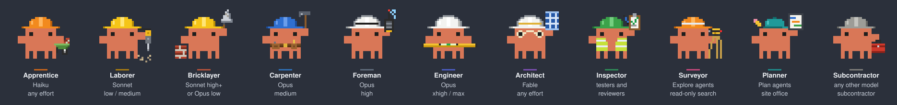

[](LICENSE)


</div>

## Install

At the prompt of a Claude Code session:

```
/plugin install site-crew --marketplace the-kringel/Site-crew
```

Answer `y` to add the marketplace and pick a scope, then start a new session: mods load when a session starts. From a shell instead:

```
claude plugin install site-crew --marketplace the-kringel/Site-crew
```

That's it. The panel opens by itself the first time an agent starts. `/crew` shows or hides it.

## What you see

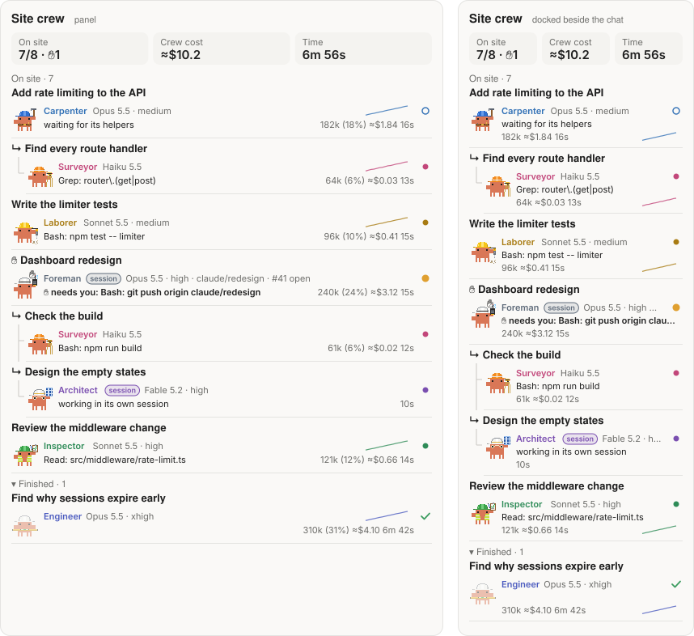

- **A tree, not a list.** An agent started by another agent sits under it, and a session started by a side session sits under that one, as deep as it goes.
- **What each one is doing right now:** its last tool call (`Bash: npm test`, `Read: src/…`), or a parent waiting for its helpers.
- **The numbers that matter:** context size with a small line of how it grew, cost as `/cost` counts it, and time on the job. The header adds up the crew's cost, not the orchestrator's own.
- **Side sessions** (desktop app) wear a `session` chip and show their branch and pull request. When one waits for you, its crab raises a hand, its title starts with ✋, and you get one notification.
- **Click a title** to open a subagent's transcript, or to switch to a side session.
- **Docked beside the chat**, each row takes three lines so nothing important is cut off. While anyone is working, a thin strip above the prompt shows the crew with a `Crew` button.

## Meet the crew

Every worker's role comes from the model and effort it runs on. The **model sets the band**: it is the ceiling of judgment. **Effort climbs within the band**: how much of that ceiling the worker uses, by thinking and checking more. A bigger model at lower effort usually beats a smaller one at higher effort on anything that needs judgment, so the ladder puts every Opus rung above every Sonnet rung, with one shared step where they overlap.

| | Rung | Role | Runs on | On site |
|:---:|:---:|---|---|---|
| 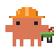 | 1 | **Apprentice** | Haiku | pushes a wheelbarrow of bricks |
| 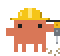 | 2 | **Laborer** | Sonnet, low or medium effort | runs the jackhammer |
| 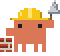 | 3 | **Bricklayer** | Sonnet at high effort or more, or Opus at low effort | lays bricks to the plan |
| 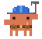 | 4 | **Carpenter** | Opus, medium effort | swings the hammer, tool belt on |
| 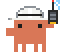 | 5 | **Foreman** | Opus, high effort | calls it in on the walkie-talkie |
| 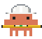 | 6 | **Engineer** | Opus, xhigh or max effort | checks it with a spirit level |
| 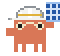 | 7 | **Architect** | Fable | holds up the blueprint |

Four roles go by the worker's job instead of its rung:

| | Role | Who | On site |
|:---:|---|---|---|
| 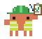 | **Inspector** | testers and reviewers: an agent type with `test`, `tester`, `review`, `reviewer`, `verify` or `audit` as a word, such as `code-reviewer` | ticks the clipboard |
| 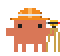 | **Surveyor** | Explore agents (read-only search) | sights through the theodolite |
|  | **Planner** | Plan agents | fills in the Gantt chart |
| 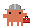 | **Subcontractor** | any other model | brings their own toolbox |

The model and effort are printed on every row too, so the role is a quick read, not the only one.

## How it works

Site crew reads what Claude Code and the desktop app already report. Nobody has to call a tool or follow a prompt for the panel to work, and it adds nothing to the system prompt.

| What | Where it comes from |
|---|---|
| Subagents, nested ones included | the engine's own agent list: parent, model, effort, live context, cost as `/cost` counts it |
| What an agent is doing | its tool calls as they happen |
| Side sessions, at any depth | the desktop app's list of linked sessions, which names who started each one |
| A side session waiting for you, its cost and its own subagents | a small status file each started session writes to `~/.claude/site-crew/sessions/`, read by the session that started it |

Everything stays on your machine: the mod makes no network calls. Costs are the same estimates `/cost` shows, not a bill.

## Commands and settings

| | |
|---|---|
| `/crew` | Show or hide the panel |
| `/crew open` | Open the panel, or bring it forward |
| `autoOpen` setting | `yes` (default) opens the panel when the first worker starts; `no` waits for `/crew` |

Change `autoOpen` in `/config`, or for a mod loaded by hand in `~/.claude/settings.json`:

```json
{ "pluginConfigs": { "site-crew": { "options": { "autoOpen": "no" } } } }
```

## Good to know

- **Where it runs:** the panel draws in the Claude Code desktop app, the terminal and VS Code. Side sessions exist only in the desktop app, so the session rows appear there.
- **Workflow agents** (the `Workflow` tool) are not in the engine's agent list and do not show yet.
- **Early access:** Claude Code marks the mod API as early access; a future release may need an update here.

## Developing

Run it from a clone for one session:

```
claude --plugin-dir <path to this repo>
```

Check and test it:

```
claude plugin validate .
```

```
claude plugin test .
```

The crew lives in [`hooks/crew-art.mjs`](hooks/crew-art.mjs): each role is a few rows of pixel art on the shared crab, with its own CSS animation. After changing one, redraw the lineup and the role badges:

```
node docs/gen-crew-lineup.mjs
```

## License

[MIT](LICENSE). The crab and its drawing helpers are adapted from savvy-progress in [the-kringel/diabolic-savvys](https://github.com/the-kringel/diabolic-savvys), itself a fork of [johnnyvizz/claude-kit](https://github.com/johnnyvizz/claude-kit).
